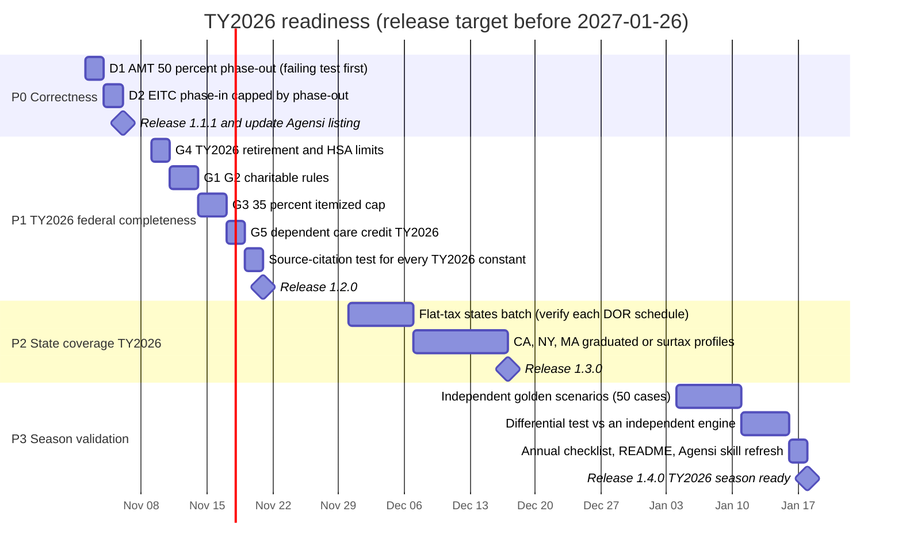

# TY2026 Filing-Season Readiness Plan

_Audit date: 2026-10-30. Target: planning-grade readiness before the TY2026 filing season opens in late January 2027._

## Verdict

Not ready. Federal TY2026 tax tables are correct, but two calculation defects, several missing TY2026
OBBB provisions, stale retirement limits, and near-zero state coverage block a TY2026 readiness claim.

Scope note: "ready" means ready for TY2026 estimation and planning. Filing-grade return generation stays
blocked by the filing-engine investment gate and is out of scope for this plan.

## Audit Findings

### Verified correct

Checked against Rev. Proc. 2023-34, 2024-40, 2025-32, and the SSA wage base announcements.

- Ordinary brackets, all four filing statuses, TY2024 through TY2026.
- Standard deduction and additional age 65 or blind amounts.
- Capital-gain 0%, 15%, and 20% thresholds.
- AMT exemption amounts, phase-out start thresholds, and the 28% bracket threshold.
- EITC maximum credits, earned-income amounts, phase-out ranges, and investment-income limits.
- CTC $2,200 with $1,700 refundable, and the $200,000/$400,000 phase-out.
- Enhanced SALT cap ($40,000 TY2025, $40,400 TY2026) with the 30% MAGI phase-down.
- QBI thresholds, including the wider TY2026 phase-in range.
- Social Security wage base: $168,600, $176,100, $184,500.
- Build passes; 315 of 315 tests pass.

### Defects (reproduced against the built engine)

| ID | Severity | Defect | Reproduction | Impact |
|----|----------|--------|--------------|--------|
| D1 | P0 | AMT exemption phase-out uses 25% for every year. OBBB raises it to 50% from TY2026. | TY2026 single, AMTI $683,900: engine exemption $44,125, correct $0 | AMT understated by about $11,500 in this case; affects every TY2026 filer above $500,000 / $1,000,000 AMTI |
| D2 | P1 | EITC phase-in branch skips the AGI phase-out. IRC 32(a)(2) caps the credit by the phase-out computed on the greater of AGI or earned income. | TY2025 single, 0 children, earned income $8,000, AGI $25,000: engine $612, correct $0 | Overstated refundable credit when non-earned, non-investment income (pension, unemployment) is high |

### TY2026 gaps (not modeled)

| ID | Provision | Current state |
|----|-----------|---------------|
| G1 | Non-itemizer charitable deduction ($1,000 single, $2,000 MFJ), from TY2026 | Absent |
| G2 | 0.5% of AGI floor on itemized charitable contributions, from TY2026 | Absent |
| G3 | Itemized deduction benefit limited to 35% for the 37% bracket, from TY2026 | Absent |
| G4 | TY2026 retirement limits: 401(k) $24,500, IRA $7,500, 50+ catch-up $8,000, IRA catch-up $1,100, ages 60 to 63 $11,250, HSA limits | Data only covers TY2024 and TY2025 |
| G5 | Child and Dependent Care Credit TY2026 rate schedule (OBBB) | Reference text shows pre-OBBB 20% to 35% schedule |
| G6 | State numeric estimates for TY2026 | Only AK, FL, NH, NV, SD, TN, TX, WY. No state with a broad income tax, including CA, NY, and MA |

Values in G1 to G5 come from IRS releases and secondary summaries. Each one must be re-verified
against the primary source (IRC section, Rev. Proc., or Notice) when it is implemented.

### Product fit

- Positioning as a privacy-first planning engine, not filing software, is sound and stated clearly.
- Fail-closed state behavior is correct, but it currently makes `calculate_total_tax`,
  `compare_state_taxes`, and `analyze_relocation_taxes` unusable for most US residents.
- 44 tools have overlapping entry points (`calculate_total_tax`, `generate_full_tax_report`,
  `generate_tax_plan`). The Agensi skill routes around this, but the overlap is worth consolidating later.

## Status After 2026-10-30 Work

Verdict: TY2026 federal planning is ready for the modeled scope. State coverage and a few form-level confirmations remain before calling the full season ready.

### Done

| Item | Result |
|------|--------|
| D1 AMT 50% phase-out | Fixed; TY2024/TY2025 keep 25% |
| D2 EITC phase-in cap | Fixed |
| D3 AMT standard deduction add-back (Form 6251 line 2a) | Found and fixed; AMT was understated for every standard-deduction filer |
| D4 AMT Part III stacking and line 40 cap | Found by the differential test and fixed |
| D5 TY2026 planning tools used TY2025 401(k), HSA, SEP limits | Fixed via one year-keyed limits table; SEP now 20% of net SE earnings |
| D6 `get_tax_deadlines` errored by default | TY2026 deadlines added |
| D7 `check_credit_eligibility` used TY2024 CTC/EITC limits and offered expired EV and energy credits | Now year-aware |
| G1 to G5 | Done, plus Schedule 1-A in the engine and the $400 minimum QBI deduction |
| G6 states | CA, GA, IL, IN, KY, MA, MI, NC, NJ, OH, PA, VA added for TY2026 |
| Differential test | 53/53 synthetic scenarios match PSL Tax-Calculator 6.8.5 within $1 |
| D8 W-4 Step 3 used $2,000 per child | Uses the year's amount ($2,200 on the 2026 Form W-4) |
| Premium Tax Credit | TY2026 annual estimate added (Rev. Proc. 2025-25) |
| D9 Student loan interest and Saver's Credit screens used TY2024 limits | Year-keyed from Rev. Proc. 2023-34, 2024-40, 2025-32 and Notices 2023-75, 2024-80, 2025-67 |
| D10 Stale reference text (gift exclusion, qualifying relative test, SALT, MFS comparisons) | TY2026 values added from Rev. Proc. 2025-32 and Notice 2025-67 |
| D11 9 production dependency advisories, 1 critical | MCP SDK 1.32.2, zod 4.6.7, transitive refresh; `npm audit` reports 0 |
| Differential script | Moved to `scripts/differential/` with pinned requirements; optional, not in CI |
| D12 SALT not added back for AMT in the full report, health check, mortgage tool, and planner | Fixed; planner takes `itemizedStateAndLocalTaxes`; 2 differential scenarios added |
| D13 Full report ignored the TY2026 charitable floor and could not take TY2026 facts | Fixed |
| D14 Health check and document checklist offered expired EV and solar credits for TY2026 | Fixed |
| PTC Alaska and Hawaii | 2025 HHS poverty lines added |
| G6 states, third batch | MI and IN added for TY2026 |
| D15 `analyze_paycheck` ignored CTC and other credits | Fixed; takes dependents, age 65, and Schedule 1-A facts |
| D16 `simulate_tax_scenario` lacked TY2026 facts and the SALT AMT add-back | Fixed |
| D17 Additional Medicare Tax used SE profit instead of net earnings | Found by golden cases and fixed |
| Golden worksheet cases | 50 of 50 match within $1 in CI (`scripts/golden/`) |
| PTC exceptions | Monthly allocation, below-100% exception, MFS Exception 2 added |
| Suite | All tests pass; differential 53 of 53; golden 50 of 50 |

### Remaining for TY2026 (priority order, updated 2026-11-01, fourth pass)

| Priority | Item | Status | Blocker or next action |
|----------|------|--------|------------------------|
| P1 | Upload the refreshed Agensi skill ZIP | Ready | 1.2.0 released 2026-11-01 |
| P1 | New York TY2026 profile | Blocked | NY DTF has not published the TY2026 IT-201 rate schedule; withholding tables are not a filing source |
| P2 | Confirm against final 2026 forms in January 2027: NC standard deduction, Form 6251 treatment of the non-itemizer charitable deduction, Publication 509 dates, CA Schedule Z and exemption credits | Waiting | Final forms publish January 2027 |
| P3 | Premium Tax Credit: shared-policy allocation (Part IV) and year-of-marriage calculation (Part V) | Open | Not modeled; tool output says so |
| P3 | Other state profiles | Open | AZ: ADOR says 2026 standard deduction is pending legislative conformity. CO: TABOR temporary rate cut for 2026 not yet certified, and CO taxes federal taxable income. UT: needs the taxpayer credit model and 2026 HB 210 changes. Others not yet sourced |
| P3 | Trump Accounts, scholarship credit (TY2027), adoption credit refundability | Reference only | Listed in the law change registry; not calculated |

## TY2026 Law Changes Versus Earlier Years

Inflation adjustments (brackets, standard deduction, limits) are year data in `src/data/tax-brackets.ts` and
`src/data/contribution-limits.ts`. Rule changes live in `src/data/law-changes.ts`, keyed by the first tax year they
apply, each with a citation and a primary-source link. `what_changed_between_tax_years` prints them by year.

Effective TY2025 (taxable years beginning after December 31, 2024): standard deduction increase, $2,200 CTC,
$40,000 SALT cap, tips, overtime, vehicle loan interest, and senior deductions (through TY2028).

Effective TY2026 (taxable years beginning after December 31, 2025): AMT phase-out at 50% from $500,000/$1,000,000,
2/37 itemized deduction limit, non-itemizer charitable deduction, 0.5% charitable floor, 50% dependent care
credit schedule, $7,500 dependent care exclusion, wider QBI phase-in and $400 minimum, clean vehicle and home
energy credits ended, Premium Tax Credit repayment caps removed and 400% limit back, HSA plan eligibility
changes, Trump Accounts.

## Plan

### Exit criteria per phase

| Phase | Done when |
|-------|-----------|
| P0 | Both reproductions above are regression tests that fail before the fix and pass after; full suite green |
| P1 | Every TY2026 constant has a cited primary source in code and a test; G1 to G5 closed or explicitly failing closed |
| P2 | Each added state profile cites the state revenue department schedule; unsupported statuses still fail closed |
| P3 | 50 golden scenarios match hand-worked IRS worksheet results within $1; differential test has no unexplained gaps |

### Open decisions

1. Which states to prioritize in P2. Proposal: flat-tax states first (cheapest per state), then CA, NY, and MA.
2. Which independent engine to diff against in P3. Its TY2026 OBBB coverage must be confirmed before relying on it.
